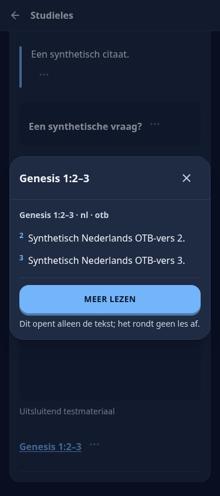

# CFM: plaatsing, persoonlijke lessen van 2027 en verwijzingen

## Gevonden oorzaken

1. `/live` (Spelen) renderde `ProgramContextPanel` boven het spellenoverzicht. Die studiehero is daar verwijderd; Vandaag is niet aangepast.
2. De archiefingang ‘Eerdere lessen’ stond ná de volledige weeklijst. Dezelfde link staat nu vóór de eerste weekkaart.
3. De cursuslijst en ‘Cursus toevoegen’ filterden uitsluitend op de actieve contentcollectie. De bestaande CFM-programmacursussen zijn nu daarnaast beschikbaar vanuit het geregistreerde programma-anker, met de gewone publicatie-, zichtbaarheids- en enabled-controles. Er worden geen cursussen of inschrijvingen aangemaakt en de actieve schriftbron wordt niet gewijzigd.
4. De bron van 2027 gebruikt nieuwe blok-ID’s. Daardoor herkende de bestaande persoonlijke indeling de bronvermeldingen en dubbele weekkop niet als metadata; de aanvullende sectie ‘Hulp bij de Schriften’ had ook geen overrides zoals in 2026. Pasen en Kerstmis hebben bovendien twee hoofdkoppen en vielen terug op de volledige les.
5. De eerdere verwijzingsreparatie bereikte de nieuwe resolver niet voor gepubliceerde verwijzingen met de opgeslagen diagnose `UNRESOLVED`: zowel de reader-DTO als de preview-API blokkeerde ze vooraf. Nu mogen uitsluitend opnieuw bewijsbare schriftverwijzingen door naar de bestaande resolver. URL, label en eventuele expliciete editiegegevens moeten overeenkomen; nummeringsverschillen en overige handmatig geblokkeerde links blijven geblokkeerd. De Nederlandse alias ‘Markus’ ontbrak ook naast ‘Marcus’; beide worden nu herkend.

## 2027 en behoud van voortgang

De bestaande overridevoorziening heeft voor alle 52 lessen van 2027 een brongebonden lijst gekregen: 358 specifieke blok-ID’s met teksthashes voor bronvermeldingen, de dubbele weekkop en de aanvullende leeshulp. Geen runtime-trefwoordfilter en geen wijzigingen aan officiële tekst, bronbestanden, blok-ID’s of gepubliceerde revisies. De volledige les blijft beschikbaar, ook voor annotaties op blokken buiten de persoonlijke route.

2027 gebruikt planversie 3. Alle lessen, inclusief de twee feestweken, hebben zes niet-lege stappen. De bestaande inhoudelijke voortgangsbrug is uitgebreid voor de vorige zesstappenindeling: een nieuwe stap is alleen voltooid als alle bronstappen die zijn inhoud bevatten voltooid waren; begonnen inhoud blijft bezig. Oude rijen blijven behouden en bestaande nieuwe rijen worden niet overschreven. Dubbele aanroepen maken geen dubbele voortgang. Weekkaarten tellen uitsluitend de nieuwste aanwezige planversie per revisie.

Alle 52 plannen van 2026 zijn met de oorspronkelijke functie vergeleken en zijn exact gelijk gebleven, inclusief blokverdeling en vingerafdrukken. De bestaande zeven-naar-zesstappenbrug blijft gecontroleerd via de bestaande integratiesuite.

## Verificatie

- `test:cfm-personal`: **101 geslaagd**; inclusief archief vóór de weeklijst via gerenderde component en geen studiehero op Spelen.
- `test:cfm-2026`: **35 geslaagd**; controleert ook alle 52 schone routes van 2027, hashes, zes niet-lege stappen, weekkoppen en onveranderde bron.
- Annotaties: **56 geslaagd**; geen annotatie-UI of selectoren gewijzigd.
- Programma-/catalogusintegratie: **9 geslaagd**, inclusief CFM naast een andere actieve bron, ingetrokken zichtbaarheid/publicatie en behoud van oude, volledige, gedeeltelijke en begonnen voortgang.
- Bestaande stapintegratie: **9 geslaagd**, inclusief de oudere zevenstappenvoortgang.
- Verwijzingsintegratie: **17 geslaagd**. Een gepubliceerde `UNRESOLVED` Bijbelverwijzing wordt klikbaar en opent het juiste interne hoofdstuk/vers, zonder auditwrite of herimport. Ingetrokken leesrechten leveren geen interne tekst op.
- Echte reader-browsercontrole: **29 scenario’s geslaagd**, zonder pageErrors. Het nieuwe scenario klikt een eerder geblokkeerde verwijzing open, gaat met ‘Meer lezen’ naar de interne schriftlezer en keert naar de les terug. Bestaande scenario’s omvatten vijf UI-talen, licht/donker, kleine schermen, 200% tekst, conflicten en netwerkfouten.
- Gerichte ESLint, TypeScript/productiebuild en native-inventarischeck geslaagd. De bestaande gegenereerde broninventaris is bijgewerkt.

Screenshot: ingelogde, geïsoleerde testomgeving met uitdrukkelijk synthetische les-/schrifttekst; geen productie- of fysiek iPhone/Safari-onderzoek.

## Bescherming en grenzen

Geen productiequery, productie-import, reset, migratie, deployment of merge. Geen wijzigingen aan annotatievensters, citaten/previews daarin, markeringen, bladwijzers of privénotities. Video’s, audio, les-/cursusidentiteiten en de drie gewone leesmethoden blijven op hun bestaande codepaden. Voortgangsdekking schrijft uitsluitend via de bestaande studiestappentabel bij normaal gebruik; er is geen dataconversiescript voor productie.

Interne navigatie blijft afhankelijk van daadwerkelijk aanwezige en toegankelijke schriftcontent. Ontbrekende edities of vertalingen worden niet verzonnen; de bestaande veilige terugval blijft gelden. Historische diagnoses worden niet stil in de database herschreven.

## Aanvullende CI-controle vóór merge

De volledige 2026-importbrowsertest verwachtte nog dat Nieuwe Testament-verwijzingen niet klikbaar waren. Die verwachting is aangepast aan de gevraagde reparatie: zonder interne NT-editie opent de verwijzing de juiste officiële NT-bron, zonder substitutie door een OT-hoofdstuk. Een afzonderlijke controle kiest een echte `unverified-numbering`-verwijzing uit de gepinde bron en bevestigt dat die niet klikbaar wordt. De blokkadecontrole blijft dus bestaan voor inhoudelijk afwijkende verwijzingen.
