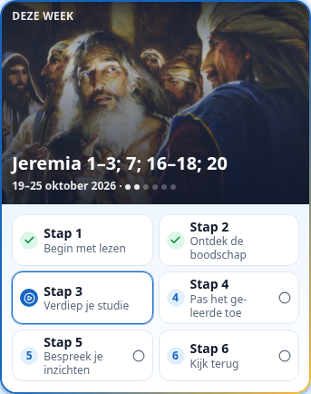
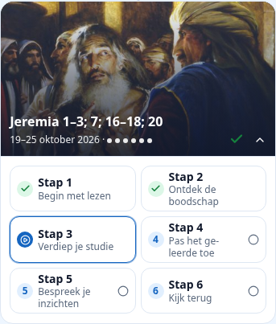
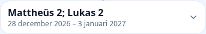
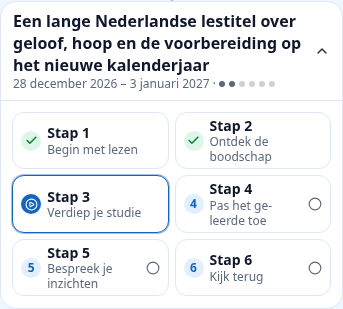

# CFM-leskaarten: compacte afbeeldingsoverlay

## Oorzaak en wijziging

PR #208 gaf `ActiveChapterCard` expliciet `imageSrc={null}` en plaatste een afzonderlijke `LessonImage` vóór de stappen. Daardoor bleven titel en datum in de tekstkop staan en volgde daaronder nog een beeldblok. Andere open kaarten hadden eveneens een tekstknop gevolgd door een los beeld.

`CfmWeekPath.tsx` gebruikt nu één lokale `LessonHeading` voor de open kaarten in Stap voor stap. De officiële afbeelding vormt de achtergrond, met de bestaande Versado-overlaygradient (`from-vs-overlay/90 via-vs-overlay/50`) en de bestaande titel-/datumhiërarchie onderaan. Voortgangsstippen, voltooiingsicoon, uitklapknop en stapstatussen blijven behouden. De beeldruimte reserveert 16:9; het tekstelement deelt dezelfde gridcel en kan de kop hoger maken bij lange titels of grote tekst, zodat niets wordt afgekapt. `object-cover` vult het vlak zonder vervorming, met dezelfde gecentreerde uitsnede als de bestaande actieve kaart.

`ActiveChapterCard` in `reading/pathParts.tsx` krijgt één optionele `header`-slot. CFM gebruikt die uitsluitend bij Stap voor stap om het bestaande weeklabel linksboven op de afbeelding te houden. De bestaande blauwe/gouden rand, bodyachtergrond en afrondingen blijven uit die gedeelde component komen. Alle andere aanroepers behouden de bestaande standaardkop. Vrije studie is niet aangepast.

De zes bestaande stapkaarten staan direct onder de kop, nu consequent in twee kolommen. Volgorde, statusbepaling, links en callbacks zijn ongewijzigd. Ingeklapte kaarten monteren geen afbeelding en houden hun oorspronkelijke `Heading`, klassen en bediening. Zonder beeld of na een laadfout blijft de volledige tekstkop met datum en voortgang zichtbaar, zonder lege beeldruimte of vervangend beeld.

## Gewijzigde bestanden

- `src/components/study/CfmWeekPath.tsx`: alleen kop-/beeldpresentatie en tweekolomsraster.
- `src/components/reading/pathParts.tsx`: optionele kopinhoud met ongewijzigde standaardweergave.
- `tests/cfm-card-overlay.browser.mjs`: gerichte componentbrowserfixture met geometrie-, interactie- en foutcontroles.
- `docs/native-feature-parity.inventory.json`: opnieuw gegenereerde bestaande broninventaris.
- Dit verslag en vier mobiele screenshots.

Geen wijzigingen aan schriftverwijzingen, schriftlezer, mediaweergave in lessen, annotaties, gegevens, import/publicatie, lesidentiteiten, voortgang of jaarwisseling.

## Controles

- `npm run test:cfm-personal`: 98 tests geslaagd.
- Gerichte gedeelde leespad-/leescursustests en CFM-deelname: 50 tests geslaagd.
- Gerichte ESLint en TypeScript: geslaagd; productiebuild geslaagd.
- Browserfixture met de echte CFM- en gedeelde kaartcomponenten: 320/375/390 px, licht/donker, 100/200% tekst; lange titel op afbeelding, beide jaren, drie stapstatussen, toetsenbord en focus, meerdere kaarten openen/sluiten, geen horizontale scroll, tekst volledig binnen de beeldkop, geen overlap met stappen, foutfallback (ook HTTP 404) en vertraagd beeld zonder verspringende kophoogte. Vrije studie is bovendien vóór/na pixelgelijk vergeleken. Geen browserfouten.
- Vergelijking met de component uit mergecommit `b28db54b` in dezelfde fixture op 375 px: actieve kaart **633 → 434 px** (circa 32% lager); ingeklapte kaarthoogte exact gelijk. Resultaat: [results.json](screenshots/cfm-overlay/results.json).

Herhaal de browserfixture met een lokaal bestand van de officiële lesafbeelding (CFM 2026 les 43):

```sh
CFM_OVERLAY_IMAGE=/pad/naar/officiele-afbeelding.jpg \
PLAYWRIGHT_MODULE=/pad/naar/playwright \
CHROMIUM_PATH=/pad/naar/chromium \
node tests/cfm-card-overlay.browser.mjs
```

De fixture vervangt uitsluitend datahooks, I18n, Next Link en Next Image; de productiecomponenten en CSS worden daadwerkelijk gerenderd. Dit is geen productie-/NAS-test of test op een fysiek toestel. De screenshots gebruiken een echte officiële afbeelding. De ontbrekende afbeelding en lange overgangstitel zijn expliciete testgegevens.

## Mobiele screenshots (375 px)

Actieve kaart (weeklabel op de afbeelding, met een subtiele donkere bovengradient voor contrast; de titel/datum en totale kaarthoogte behouden hun positie):



Andere open kaart:



Ingeklapte kaart:



Zonder afbeelding:


