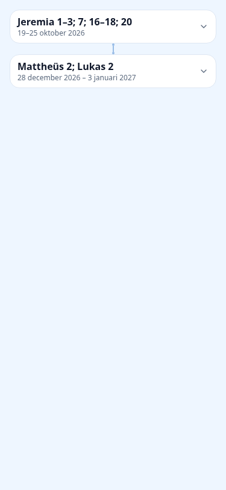
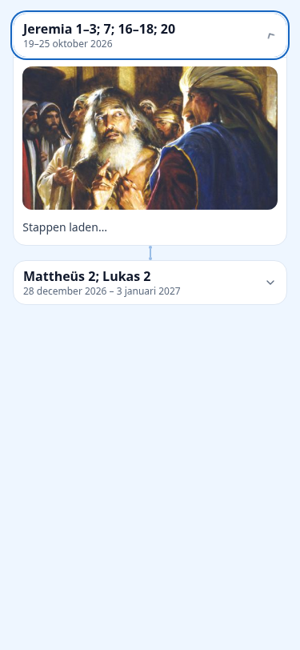

# CFM: verwijzingen, jaartallen en lesafbeeldingen

## Oorzaken en wijziging

- De resolver herkende officiële URL's uitsluitend voor Boek van Mormon, Leer en Verbonden en Parel van Grote Waarde. Oude Testament-doelen werden bij import naar OTB vertaald; Nieuwe Testament-doelen bleven URL's. De OTB-import ondersteunt inmiddels beide testamenten. `references/bible.ts`, `otb.ts` en `resolver.ts` koppelen bewezen Bijbel-URL's aan bestaande OTB-collecties en `/scripture/<chapter>#vers-N`. Bestaande gepubliceerde URL-doelen en `unverified-range`-doelen worden tijdens resolutie verwerkt, zonder revisie/importwijziging. De URL bepaalt boek en beginhoofdstuk; het label moet overeenkomen. Hoofdstukbundels gebruiken het bestaande passagekeuzemechanisme; versbereiken worden volledig gevalideerd tegen de aanwezige tekst.
- `PersonalStudyParts.formatWeekPeriod` vroeg geen jaar aan Intl. Alleen de formatteringsoptie is toegevoegd; dezelfde datumregel en klassen blijven gebruikt. Intl toont bij overgangsweken beide jaren.
- `CfmWeekPath` ontving al `imageMediaId` uit `catalogue.lessonImageMedia` (eerste inhoudelijke figuur ≥300 px, gekoppeld aan de gepubliceerde revisie en READY-media). De afbeelding stond alleen als decoratieve thumbnail/header weergegeven. Ze staat nu in de open inhoud, via bestaande geautoriseerde `/api/study-media` en Next Image. Een vaste 16:9-ruimte, object-contain, lazy loading en verwijderen bij laadfout voorkomen vervorming en blijvende lege foutcontainers. Gesloten kaarten monteren geen afbeelding; de actieve kaart is volgens het bestaande contract altijd open.

## Behouden gedrag en grenzen

- Annotatiecomponenten, selectoren, vensters, notities, bladwijzers en markeringen zijn niet gewijzigd. Geen alinea, citaat, tekstpreview of extra tekstveld toegevoegd.
- Geen database- of importwijziging; lesidentiteiten, inschrijvingen, voortgang, video-inhoud en de drie leesmethoden blijven op bestaande codepaden.
- Boek van Mormon, Leer en Verbonden en Parel van Grote Waarde houden hun bestaande bewijs per hoofdstuk en label/URL-controle. Hun bestaande uitzonderingen voor hoofdstukbundels blijven gelden.
- Lofzangen houden de bestaande slug/nummerkoppeling en toegangscontrole; `/dev/lofzangen?lofzang=N` als intern beschikbaar, anders de bestaande officiële bron. Geen schriftlezerroute voor lofzangen.
- NT selecteert uitsluitend de toegankelijke OTB-editie met de taal van de bron (`nld/eng/deu/fra/spa` → `nl/en/de/fr/es`); ontbrekende interne tekst valt terug op de gecontroleerde officiële URL. Geen stille wissel naar een andere taal of editie. Nederlandse en Engelse boeklabels worden ondersteund. OT houdt het bestaande Nederlandse OTB-profiel. Uitbreiding van OT naar andere bronprofielen en boeklabels in andere talen valt buiten deze reparatie.
- Maximaal 40 passages en 40 verzen per expliciete preview blijven gelden. Verschillende boeken in één tekst werken via hun afzonderlijke officiële links; één URL bewijst geen tweede boek. De bestaande reader/previewnavigatie en terugkeer zijn ongewijzigd.

## Screenshots

Mobiele componentfixture met de echte `CfmWeekPath`, 375 × 812, officiële afbeelding uit de bijbehorende Nederlandse bronles 43 (2026). Alleen I18n/datahooks/Next Link/Image zijn in de lokale fixture vervangen. Dit zijn geen screenshots van productie of van een volledige ingelogde sessie.

## Technische controles

- 91 tests geslaagd: nieuwe referentie-/datumgevallen, bestaande resolver, CFM-verwijzingen, programma, persoonlijke studie, stapnavigatie, video en annotatieclient/selectoren/versmenu.
- 63 tests geslaagd: officiële media-/afbeeldingsbronnen, 2027, leestypografie en de drie leescursussen/leesmethoden.
- `prisma generate`, `tsc --noEmit`, gerichte ESLint en `npm run build` geslaagd. Prisma-generatie vernieuwde uitsluitend de lokale gegenereerde client.
- Lokale browsercomponentfixture geslaagd: toetsenbord, gesloten/open/opnieuw open, meerdere kaarten, ontbrekende afbeelding, afbeeldings-error-handler, geen horizontale overflow op 320/375 px in licht/donker. Bij een afbeelding wordt vóór laden ruimte gereserveerd. Een echte trage netwerkverbinding en volledige sessieterugkeer zijn hiermee niet end-to-end bewezen.
- De eerste geïsoleerde integratierun voltooide de migratiecontroles maar kon de testserver niet starten doordat de productiebuild nog liep. De runner wordt na de build opnieuw uitgevoerd; resultaat en GitHub Actions worden in de PR vastgelegd.
- Productie/NAS niet benaderd; geen reset, productie-import, deployment of merge uitgevoerd.
