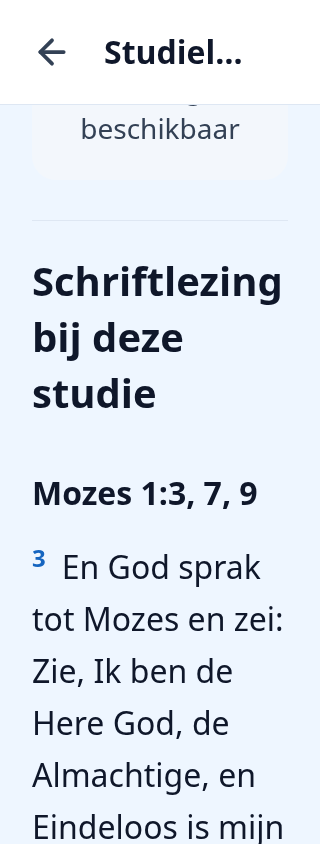
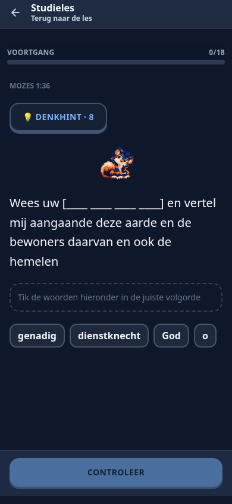

# Officiële CFM-pilot — 5–11 januari 2026

Onderdeel van draft-PR #218, uitsluitend `cfm-old-testament-2026/02`:
**Mozes 1; Abraham 3**. Geen productie-import, deployment of merge.

## Definitief productbesluit

**P35 vervangt P34** uit het [besluitenregister](content-architecture-v2/06-DECISIONS-AND-OPEN-QUESTIONS.md).
De eerdere beperking tot uitsluitend reeds zichtbare CFM-tekst geldt niet meer.
Officiële aanvullende verzen mogen binnen de persoonlijke stap worden aangeboden.
De regel blijft: **eerst lezen, daarna vragen**. Geen vragen over alleen een link,
een verborgen generatorbron of niet-getoonde verzen. De officiële CFM-lesbody
blijft intact. De bestaande [roadmap](content-architecture-v2/04-IMPLEMENTATION-ROADMAP.md)
blijft de enige planning; B–D en massale uitbreiding zijn niet gestart.

Lezen blijft zelfstandig mogelijk: geen quizplicht, minimumleestijd, scrollbewijs
of correctheidsdrempel voor een volgende stap. Lezen/afvinken levert geen quiz-XP.

## Selectie en broncontrole

Alle aanvullende verzen komen uit de bestaande Nederlandse `pgp`-uitgave
(`ContentCollection.work=pgp`, `editionKey=pgp`, `language=nl`, werksoort `SCRIPTURE`).
De runtime leest de bestaande toegankelijke `Book`/`Chapter`/`Verse`-rijen en
controleert de volledige hoofdstukhash. `prisma/pgpContent.json` is uitsluitend de
gecontroleerde bron voor offline rapportage en de eigen testdatabase, geen
verborgen runtimefallback of automatische import. Geen productie-editie opgevraagd.
De bestaande leesrechten en publicatiestatus gelden; geen stille andere taal/uitgave.

| Stap | Reeds zichtbare tekst / aanvullende lezing | Verband met de officiële opdracht | Vragen |
|---|---|---|---|
| 1 | Bestaande citaten Genesis 1:1 en Mozes 1:36 | De officiële openingsalinea's over schepping en Mozes' vraag naar de aarde | Bestaande pool, drie bestaande identiteiten behouden |
| 2 | Mozes 1:4, 6, 12 | Exact de verzen uit `b-p3` over Gods kind zijn en Mozes' ontmoeting met Satan | P04–P06 |
| 3 | Mozes 1:3, 7, 9 | `b-p5` vraagt andere verzen in Mozes 1 te onderzoeken. God maakt zich bekend, toont Mozes zijn werk en Mozes ervaart Gods heerlijkheid. Expliciete selectie binnen dat hoofdstuk; geen extra hoofdstuk | P07–P09 |
| 4 | Mozes 1:13, 16, 18 | `b-p7`/`b-p8` en de sectiekop verwijzen naar 1:12–26 / 13–18: identiteit, aanbidding en onderscheid bij het weerstaan van Satan | P10–P12 |
| 5 | Mozes 1:20, 21, 25 | `b-figure1_p1` vraagt te lezen hoe Mozes Satan weerstond. Mozes roept God aan, beveelt Satan te vertrekken en krijgt daarna zijn opdracht bevestigd. Expliciete vervolglezing binnen Mozes 1 | P13–P15 |
| 6 | Mozes 1:39; Abraham 3:24, 25 | `b-p10`/`b-p11`: Gods werk en het doel van het aardse leven; binnen de opgegeven 1:31–39 en 3:22–28 | P16–P18 |

Dit is een door Codex onderbouwde en reproduceerbare selectie, ter beoordeling in
de draft. De eigenaar heeft de bronverbreding toegestaan; dat is geen onafhankelijke
menselijke inhoudelijke goedkeuring van iedere vraag. De
[vraagcontrole](cfm-pilot/2026-02-voorstel.md) bevat de exacte passage, officiële URL,
vraagvorm, seed, correcte antwoorden, afleiders en geschiktheidsreden per concept.
P01–P18 zijn documentnummers; de bestaande stap-1-pool heeft vier kandidaten waaruit
de bestaande deterministische planner drie kiest. Ook die vierde kandidaat is
beschreven. Geen oude vraag/seed vervangen om een documentnummer af te dwingen.

Het [pilotmanifest](../data/study-content/cfm-pilot-2026-02.json) pint werk, week,
CFM-editie, taal, persoonlijk plan, stapvingerafdruk, bloktekst, verwijzingsdoelen,
PGP-hoofdstukhash, versnummer, vraagvorm en seed. Stap 3 en 5 zijn expliciete
selecties, geen impliciete toestemming om alle hoofdstukken te toetsen.

## Architectuur en leeservaring

- `pilotReadings.ts` selecteert uitsluitend deze pilot en controleert binding aan
  de oorspronkelijke persoonlijke stap. `pilotReadingSource.ts` leest de bestaande
  schriftuurdatabase onder normale toegang; issue/submit nemen gedeelde bronlocks
  en controleren beschikbaarheid en hashes opnieuw.
- `StudyReader` toont de geselecteerde verzen na de ongewijzigde stapinhoud en vóór
  de bestaande vragenactie. De volledige week toont dezelfde vijftien verzen eenmaal,
  gegroepeerd per stap. Stap 1 dupliceert de al aanwezige citaten niet.
- `ScriptureVerses` hergebruikt de bestaande versweergave uit `ReferencePreview`
  (nummering, taal, leesbare alinea's, contrast en relatieve tekstmaten). Geen tweede
  schriftuurlezer, navigatiesysteem of annotatiemodel. De nieuwe sectie staat buiten
  de oorspronkelijke annotatieroot; blok-ID's, selectors en body blijven gelijk.
- De bestaande `readingVisitProof` wordt gebonden aan gebruiker, sessie, revisie,
  vraagplan en stap/week. Een directe pilotvragenlink gaat eerst naar de leesstap.
  Het bewijs bevestigt aanbieden, geen gemeten leestijd of bewering dat iemand
  daadwerkelijk heeft gelezen. De handtekening staat alleen in sessionStorage en
  de URL-fragmentfallback, niet in querystring of serververwijzer.
- De bestaande vraagpagina start de set zonder een tweede startscherm. Het bestaande
  `ExerciseSessionQuestions`, antwoordcontrole, feedback, hoofdstukcorrectieronde
  en resultaatweergave worden hergebruikt. Geen nieuwe vragenengine of AI.
- Een beperkt sessionStorage-checkpoint bewaart bevestigde antwoorden en reviewpositie.
  `resumeStudyExerciseSession` controleert eigenaar, leeftijd, actuele bron/revisie,
  vraagvolgorde en eventueel reeds opgeslagen resultaat. Serverbeoordeling blijft
  leidend; een lokaal correctheidsvlaggetje verdient geen XP. Hervatten van een
  bevestigde inzending herstelt ook de gedeelde voortgangscache.
- Ontbrekende/verborgen/veranderde of verkeerde bron: melding en geen betrokken
  vragen. Lezen, bestaand afvinken en historie blijven beschikbaar. Geen import,
  andere vertaling of afgekapt citaat als vervanging. `CFM_EXERCISES=off` stopt
  oefeningen; de beschikbare aanvullende lezing blijft zelfstandig leesbaar.

## Vraagidentiteit, XP en behoud

De bestaande generator maakt invul- en woordbankvragen. Waar/niet waar wordt niet
geforceerd wanneer de bestaande naamgebonden generator geen passende variant geeft.
Dezelfde actuele planselectie levert drie vragen per stap en dezelfde achttien in
de weekroute. Oude stap-1-ID's, seeds en credits blijven behouden; nieuwe vragen
hebben stabiele bron-/editie-/vers-/type-/seed-identiteiten. Herpublicatie maakt
verouderde sessies ongeldig zonder historische beloningen te wissen.

Geen wijziging aan `rewards.ts`, `xpRules.ts` of de centrale transactie voor XP,
competitie, reeks, prestaties en bonus. Eén logische week-contentKey met de bestaande
maximale basisbeloning; herhaalde goede antwoorden krijgen de normale korting.
Eerder fout en later goed kan ontbrekende basis-XP geven. De perfecte bonus volgt
de bestaande centrale voorwaarden en wordt maximaal eenmaal uitgekeerd. Leesreset
wist geen oefencredits. Geen nieuwe Dorp-bijdragen; canonieke BOM-READ blijft gelden.

Bestaande lesmedia, notities, markeringen, bladwijzers, leespositie, inschrijving,
les-ID's en andere CFM-weken worden niet aangepast. Er is geen nieuwe migratie.

## Verificatie en bewijssoorten

De volledige proef gebruikt echte gepinde CFM-inhoud en officiële PGP-tekst in
uitsluitend een eigen wegwerpdatabase. Oudere synthetische fixtures blijven
afzonderlijke engine-/regressietests.

| Lokale controle | Resultaat |
|---|---|
| Bron-/vraagunitcontroles, bestaande en pilot | 8/8; bronhash, letterlijke reconstructie, bekende antwoorden, verkeerde antwoorden, één passend antwoord, behoud oude stap-1-ID's en alleen één week uitgebreid |
| Geïsoleerde CFM-vraagtests | 20/20, inclusief bovenstaande 8; bestaande server-/sessie-/XP-regressies |
| Echte officiële pilot met database | 10/10; zes stappen, dezelfde 18 ID's, beide routevolgorden, eerste/perfect/herhaald/verbeterd, concurrency, replay, reset, oude credits, bronuitval, revisie en ingetrokken vragen |
| Bestaande stappen / centrale learning / Kompas met database | 9/9, 29/29, 69/69 |
| CFM-persoonlijke studie / CFM2026–2027 en media | 101/101, 35/35 |
| Annotatie-unit / geïsoleerde annotaties en migratie | 56/56; 18/18, 12/12, 10/10 en 2/2, zonder skips |
| Dorp/focus/shell / Dorp-database en migratie | 56/56, 18/18; bestaande tabellen/constraints behouden, conflictrollback en herhaalde migratie gecontroleerd |
| Native inventaris/pariteit / native regressies | Actuele inventaris; 6/6 en 56/56. Geen functionele CFM-nativepariteit bewezen |
| TypeScript en schone lokale productiebuild | Geslaagd |
| Volledige ESLint | 0 fouten, 171 waarschuwingen; waaronder bestaande waarschuwingen en de effect-startwaarschuwing in StudyExerciseClient |
| Bestaande browserregressies | 6 scenario's geslaagd, inclusief Boek van Mormon-hoofdstukvragen, correctieronde, officiële 2027-stap en lezen zonder vragen |
| Echte pilotbrowser | 4 scenario's geslaagd: week 390px/donker, stap 3 320px/licht/200%, stap 5 320px/donker/200%, ontbrekende bron. Touch/toetsenbord, geen horizontale overflow, lesbody intact, terugkeer, checkpoint en verlies van bevestigde én onbevestigde inzending |

De verloren-antwoordproef wacht expliciet tot de onderschepte serverresponse is
voltooid en afgebroken; voor de bevestigde variant wordt de opgeslagen sessie
gecontroleerd vóór herladen. Een willekeurige al zichtbare alert geldt niet als
bewijs van serveropslag. De browsercontrole bewaakt dat screenshots inhoud tonen.

Reproduceren na `npm run build`:

```bash
npx tsx --test tests/cfm-exercises.test.ts tests/cfm-pilot.test.ts
node scripts/content-architecture/test-access-isolated.mjs --focused --cfm-exercises --browser
npm run test:cfm-personal
npm run test:cfm-2026
npm run test:annotations
npm run test:annotations:integration
npm run test:dorp
npm run test:dorp:integration
npm run native:parity:check
npm run test:native:parity
npm run test:native
```

Voor alleen de pilotbrowser bestaat de lokale focusoptie
`--focused --cfm-pilot-browser --browser`; CI gebruikt de volledige CFM-suite.
GitHub Actions wordt op de daadwerkelijk gepushte eindcommit gecontroleerd;
[PR #218](https://github.com/rjgout/Versado.app/pull/218) vermeldt commit en actuele
checks. Oudere groene runs gelden niet als bewijs voor de nieuwe wijzigingen.

| Statussoort | Betekenis |
|---|---|
| Technisch geïmplementeerd | Eén pilot met zichtbare lezing, drie/achttien vragen, gedeelde routes/credits en hervatten |
| Automatisch gevalideerd | Bronhashes, letterlijke vraagreconstructie, juiste/foute antwoorden, route-identiteit, XP, historie en browserflow |
| Inhoudelijk beoordeeld | Codex heeft passages, antwoorden, vraagvormen en samenhang met de stappen gecontroleerd; geen interpretatiebeoordeling |
| Nog handmatig te beoordelen | Onafhankelijke inhoudelijke review en functionele acceptatie door de eigenaar; echte apparaten en native beperkingen hieronder |

### Mobiele screenshots van de echte pilot

Alle beelden zijn Chromium-browserproeven in portret met eigen testaccounts en
een wegwerpdatabase, geen productie- of fysieke apparaatbeelden.

| Schriftlezing 320px licht, 200% tekst | Weekvragen 390px donker |
|---|---|
|  |  |

- [Bestaand citaat stap 1](screenshots/cfm-pilot-2026-02/scripture-step1-390-dark.png)
- [Schriftlezing volledige week](screenshots/cfm-pilot-2026-02/scripture-week-390-dark.png)
- [Schriftlezing stap 5, 320px donker/200%](screenshots/cfm-pilot-2026-02/scripture-5-320-dark.png)
- [Stapvragen, 320px licht/200%](screenshots/cfm-pilot-2026-02/question-3-320-light.png)
- [Correctieronde van de officiële week](screenshots/cfm-pilot-2026-02/review-week-390-dark.png)
- [Bevestigd weekresultaat](screenshots/cfm-pilot-2026-02/result-week-390-dark.png)
- [Ontbrekende bron, doorlezen blijft mogelijk](screenshots/cfm-pilot-2026-02/missing-scripture-320-light.png)
- [Machineleesbare browserresultaten](screenshots/cfm-pilot-2026-02/results.json)

## Dekking en uitbreidingsvoorstel

Het [dekkingsrapport](CFM-VRAAGDEKKING.md) geeft met beschikbare gecontroleerde
PGP-tekst **22/624 stappen, vijf stappen met aanvullende lezing, vijftien aanvullende
verzen en één volledige officiële week**. Stap 1 was al gedekt; de toename is vijf
stappen. De overige 602 zijn niet volledig gedekt. Zonder de PGP-bron valt het
pilotaanbod veilig terug; het offline rapport bewijst geen productiepublicatie.
De historische triage van 607 ontbrekende stappen blijft als nulmeting herkenbaar.

Toetsbare uitbreiding binnen het bestaande contentbeheer, na beoordeling:

1. Voorbereiden: bestaande canonieke resolver zoekt kandidaten binnen de concrete
   stapopdracht; werk/taal/editie/rechten en volledige tekst moeten aantoonbaar kloppen.
   Brede hoofdstukopdrachten vragen een expliciete versselectie met onderbouwing.
2. Reviewbaar voorstel: per stap de zichtbaar aan te bieden lezing, bronhashes en
   maximaal drie inhoudelijk geschikte vragen uit de bestaande generator. Codex of
   beheerder controleert passage, antwoord, afleiders en opdrachtverband. Geen
   automatisch publiceren of cosmetische vraagvarianten om aantallen te halen.
3. Automatisch valideren: bronbeschikbaarheid/edities/revisies, alle aangeboden verzen,
   reconstructie van invul-/woordbankvragen, juiste en foute antwoorden, unieke
   identiteiten, exact dezelfde drie/achttien in beide routes en ontbrekende sets.
4. Bestaand beheer uitbreiden: `check/prepare/publish`, planhash, importlock,
   `StudyRevision` en bestaande `Exercise.status` blijven de bouwstenen. Voorstellen
   zijn offline of DRAFT/IN_REVIEW; bewust inhoudelijk goedkeuren vóór beschikbaarheid.
   Geen tweede CMS of nieuwe ongecontroleerde publieke publicatieroute.
5. Credits beschermen: bestaande vraag-ID's, seeds en bronidentiteiten niet herschrijven;
   wijzigingen hebben een expliciet compatibiliteitsrapport. Centrale inhoudscap en
   beloningshistorie blijven ook na revisie/reset behouden. RETIRED/REJECTED niet
   automatisch als APPROVED terugbrengen.
6. Vrijgavegate: per nieuwe jaargang een reproduceerbaar bron-/dekkingsrapport en
   inhoudelijke review vóór publicatie; kleine batches, bronfouten veilig blokkeren,
   beide routes en bestaande credits testen. Eerst dit proces op enkele beoordeelde
   weken bewijzen, niet alle 624 stappen automatisch uitbreiden.

Acceptatie voor die toekomstige beheeruitbreiding: een beheerder kan de daadwerkelijke
lezing en antwoorden inspecteren, gewijzigde bronnen blokkeren, voorstellen afwijzen
zonder automatische heractivering, en bewijzen dat eerder verdiende XP behouden blijft.
Geen open productkeuze over aanvullende lezing; de huidige grenzen zijn definitief.
De brede beheerimplementatie en overige weken vallen buiten deze pilotopdracht.

## Resterende beperkingen

Chromium op 320/390 px is browserbewijs, geen fysieke iPhone-/iPad-/Android-test.
De lokale native router heeft nog geen CFM-studielezer/vragenroute of algemeen
Bearer-contract. Native broninventaris en compilatie bewijzen geen functionele
CFM-pariteit. Zie [native pariteit](NATIVE-FEATURE-PARITY.md).
Er wordt geen volledige native ondersteuning, offlinegarantie of onafhankelijke
menselijke inhoudsgoedkeuring geclaimd. Geen productiehandelingen uitgevoerd.
