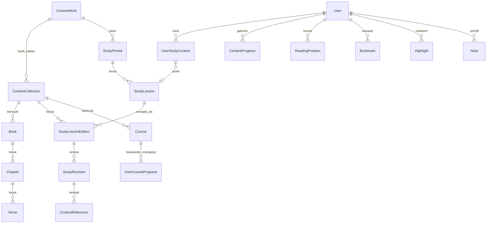
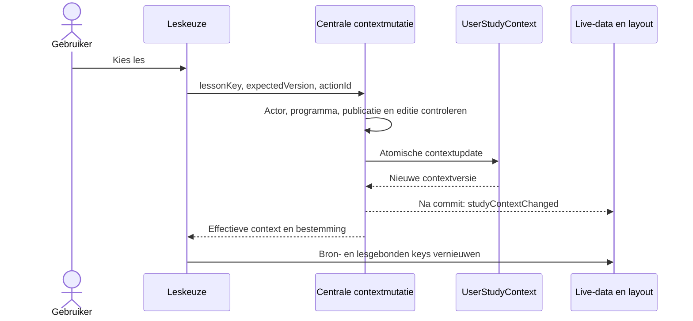
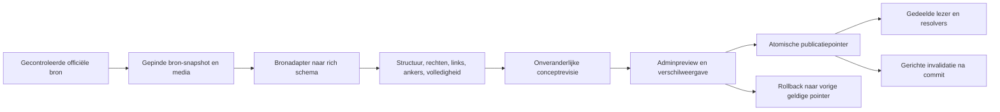

# 02 — Aanbevolen doelarchitectuur

Status: technisch voorstel voor beoordeling, geen geïmplementeerd schema of API.
Uitgangspunt: de [huidige audit](01-CURRENT-STATE-AUDIT.md).

## 1. Grenzen en verantwoordelijkheden

Er blijft één Versado-app: dezelfde shell, Today/courses/game-services,
Prisma/PostgreSQL, Socket.io, i18n en live-data. Geen los CMS, zoekcluster,
pluginframework, eventbus of tweede voortgangs-/beloningssysteem.

Vier verantwoordelijkheden blijven gescheiden:

1. Bronidentiteit en toegankelijk aanbod.
2. Gevalideerde broninhoud en publicatie.
3. Persoonlijke selectie, leespositie, gelezenstatus en oefeningen.
4. Presentatie van die gegevens in de bestaande navigatie.

De bronsoort `SCRIPTURE` versus `STUDY_PROGRAM` beschrijft de structuur, niet
de waarde als studiecontent. Bestaande podcasts zijn een behouden `OTHER`
bronfamilie; er wordt geen podcastmigratie bij dit project binnengesmokkeld.

## 2. Modellen en relaties

### Bestaande modellen behouden

`ContentCollection` blijft **één concrete editie-familie in één taal**.
`Book`, `Chapter`, `Verse`, audio, oefeningen, historische sessies, XP,
reeksen, cursusabonnementen en spelrecords blijven bestaan met hun huidige
id's. Studiecontent wordt geen kunstmatig Book/Chapter/Verse. Een officiële
opdracht in een les is geen `Exercise`.

### Voorstel voor uitbreidingen

| Model | Voorgestelde velden/relaties | Verantwoordelijkheid |
|---|---|---|
| Nieuw `ContentWork` | `key`, `kind`, `order`, `displayGroup`, gelokaliseerde labels/metadata | Logisch werk of programma; bronsoort niet uit namen of slugs raden |
| `ContentCollection` uitgebreid | Optionele/stapsgewijs verplichte relatie via bestaand `work`; `publicationState`, metadata-/publicatieversie | Taaleditie, huidige enabled/visible-vlaggen behouden |
| Nieuw `StudyPeriod` | `id`, `workKey`, officiële `sourceKey`, label, optioneel jaar, bronkalendermetadata | CFM-lesjaar; FSY-uitgave/jaar; geen gedeelde weekformule |
| Nieuw `StudyLesson` | `id`, `workKey`, `periodId`, officiële `sourceKey`, `order`, `categoryKey?`, `month?`, `startsOn?`, `endsOnExclusive?`, `retiredAt?` | Taalonafhankelijke lesidentiteit en echte kalenderindeling |
| Nieuw `StudyLessonEdition` | `id`, `lessonId`, `collectionId`, slug, `publishedRevisionId?`, `draftRevisionId?` | Eén teksteditie van een les, met actuele publicatiepointer |
| Nieuw `StudyRevision` | `id`, `lessonEditionId`, nummer, `schemaVersion`, hash, titel, `body Json`, bron-/rechtenmetadata, importRunId, auteur/createdAt | Onveranderlijke, gevalideerde tekstversie inclusief secties/blokken |
| Nieuw `UserStudyContext` | `userId`, `workKey`, `activeLessonKey?`, later `activeLessonId?`, `version`, `updatedAt` | Bewuste actieve les per programma; geen kalendergestuurde overschrijving |
| Nieuw `ReadingPosition` | `userId`, target, `revisionId?`, sectie-/blokanker, sectiefractie, `version`, server updatedAt | Exact hervatpunt; geen afronding of beloning |
| `ContentProgress` uitgebreid | `lastStudyLessonId?`, `readMarkedRevisionId?`; bestaande gelezenvelden hergebruiken | Algemene gelezenstatus per logische inhoud; onafhankelijk van positie/oefenen |
| Nieuw `ContentReference` | `id`, `revisionId`, occurrenceKey, genormaliseerd target, oorspronkelijke href/label, bekende officiële fallback, diagnose | Herleidbare verwijzing binnen de versie; oplossing dynamisch |
| Nieuw `ContentMedia` | `id`, checksum, MIME, afmetingen/duur, storageKey, bron-/licentiegegevens, status | Betrouwbaar gepinde media; geen gebruikersvaluta/voortgang |
| Nieuw `ContentImportRun` | adapter/versie, bronversie, werk/period/taal, status, lease, samenvatting, bounded foutdetails, startedAt/finishedAt | Duurzame importaudit en hervatbare batches |
| `Bookmark`/`Highlight`/`Note` uitgebreid | `verseId?` of `lessonEditionId?`, `revisionId?`, `selector Json?`, `targetKey?`, anchorStatus, mutationVersion | Bestaande annotaties en nieuwe passages in dezelfde drie tabellen |

Dit is de volledige richting, **niet** een lijst tabellen om allemaal in
fase 1 aan te maken. Het minimum per fase staat in document 04.
`ContentWork` voorkomt verspreide bronlijsten; `StudyLessonEdition` voorkomt
vermenging van logische les en vertaalde tekst; revisies maken betrouwbare
publicatie/rollback en annotatieankers mogelijk. Een los model voor ieder
blok, sectie, taal of programma is niet nodig.



De diagramrelatie actieve les wordt in fase 2 een FK. In fase 1 mag de
context een gevalideerde legacy-FSY-leskey bewaren; het is geen alternatieve
lescatalogus. Revision-body bevat media-id's en reference-id's. De bestaande
publishedContent wordt later naar een revisie overgezet, niet hergebruikt
als mutable revisie.

### Integriteit en indexen

- ContentWork.key uniek; bestaande `(work,editionKey,language)` behouden.
  Null-work collecties krijgen pas na inventaris een eigen, blijvende key.
- StudyPeriod uniek `(workKey,sourceKey)`; StudyLesson uniek
  `(workKey,periodId,sourceKey)`. Officiële key is niet een vertaald titelhash.
- StudyLessonEdition uniek `(lessonId,collectionId)`; service/DB-relaties
  garanderen dat collectie en les hetzelfde werk hebben. FK's of expliciete
  composite FK's waar dat haalbaar is; geen los collectionId uit de client.
- StudyRevision uniek `(lessonEditionId,revisionNumber)`; een pointer mag
  uitsluitend naar een revisie van dezelfde edition wijzen. Restrict op
  verwijdering van gerefereerde versies; historie wordt niet gecascadeerd.
- UserStudyContext uniek `(userId,workKey)`; les moet bij hetzelfde werk horen.
  Mutaties hebben expectedVersion en een herstelbare conflictrespons.
  Een herhaalde desired-state-mutatie veroorzaakt geen tweede effect. Bewaar
  waar nodig de laatste actionId bij de versie; een oudere retry krijgt de
  actuele context terug of een expliciet conflict, nooit een stille rollback
  naar de leskeuze van een ander apparaat. Geen generieke eventlog nodig.
- ReadingPosition heeft precies één target: chapterId **of** lessonEditionId.
  DB CHECK voor exclusiviteit; unieke `(userId,chapterId)` en
  `(userId,lessonEditionId)`. Sectie/selector wordt tegen de revisie gevalideerd.
- Annotatie heeft precies één target: vers **of** leseditie. Oude unieke
  `(userId,verseId)` blijft. PostgreSQL laat meerdere null verseId's toe;
  nieuwe bookmarkduplicaten krijgen een aanvullende unieke targetKey per
  gebruiker/leseditie. Notities en highlights mogen meerdere passages omvatten.
- Lijsten hebben tie-breaker id; studiemap gebruikt keysetpaginering
  `(createdAt,id,type)` met een begrensde limiet en filters vóór de limiet.

## 3. Contentidentiteit en meertaligheid

Gebruik drie verschillende identiteiten:

| Identiteit | Voorbeeldvorm (ontwerp) | Gebruik |
|---|---|---|
| Logische inhoud | `study:<workKey>:<periodSourceKey>:<lessonSourceKey>` | Lesselectie, expliciet gelezen, activity-key |
| Concrete editie | `collectionId` of `(work,editionKey,language)` | Toegang, getoonde tekst, speldata, leespositie |
| Tekstversie en passage | `revisionId + sectionId + blockId + selector` | Tekstspecifieke annotatie en exact hervatten |

De voorbeeldvorm verzint geen officiële CFM-id. Tijdens importvoorbereiding
worden echte identiteiten/kalender geleverd en gecontroleerd. CFM 2026 en
CFM 2027 zijn verschillende perioden binnen hetzelfde programma. Twee FSY-
lessen in dezelfde maand blijven afzonderlijke lessen; categorieën komen
uit de gecontroleerde bron.

Nieuwe Schrifturen-resolutie gebruikt het bestaande canonieke tuple
`work + editionKey + Book.key + chapter + verse-range`. Een bronlink naar
een andere canon/nummering wordt niet door positie als equivalent beschouwd.
Voortgangsleutels voor bestaande hoofdstukken blijven exact zoals ze nu
zijn. Een kleine centrale identity-service kiest de bestaande legacy-key
voor bestaande families; nieuwe families krijgen een namespace met werk en
editie. Geen massale herberekening of extra XP door sleutels te hernoemen.
Een mogelijke verdere conversie vereist een afzonderlijke alias-/backfill-
review; zie document 03.

Algemene gelezenstatus kan tussen bewezen equivalente lesvertalingen gedeeld
worden. Cursuscredits volgen hun bestaande inhouds-/vraagidentiteiten.
Leesposities en tekstmarkeringen blijven per taaleditie en tekstversie.
Een taalwissel hergebruikt een sectie alleen als de importmapping deze
equivalentie bewijst; anders krijgt de gebruiker het begin van de les of het
eigen hervatpunt in die taal. Geen automatische vertaling van notities of
projectie van character offsets op een andere taal.

De eerste CFM-uitrol omvat de volledige, gecontroleerde Nederlandse
Kom dan en volg Mij 2026-content — Oude Testament. Het model blijft
meertalig en de vijf bestaande UI-talen nl/en/de/fr/es blijven behouden.
Andere contenttalen worden alleen aangeboden als de bijbehorende inhoud
daadwerkelijk beschikbaar, gecontroleerd en gepubliceerd is. Dit is het
vastgestelde besluit D3 in document 06; geen nog open taalkeuze.

## 4. Toegang, publicatie en fullscreen contentkiezer

Eén `getContentAvailability(actor,target,purpose)`-service wordt gebruikt door
aanbod, lezen, preview, references, spelstarts en gerelateerde mutations.
Hij ontvangt een actor, geen request-scoped Next-import, en controleert:

1. enabled en zichtbaarheid/rechten.
2. bron-/editie-identiteit en ondersteunde taal.
3. publiceerbare inhoud en concrete publicatiepointer.
4. purpose: normaal lezen/spelen versus expliciete adminpreview.

Voor legacycollecties is een compatibiliteitsstatus `LEGACY` nodig: huidige
enabled/visible blijven leidend totdat hun echte inhoud is geïnventariseerd.
Nieuwe collecties starten `DRAFT` en onzichtbaar; `PUBLISHED` kan pas na
validatie van de beschikbare inhoud. Geen synthetische BOM als nul bronnen
beschikbaar zijn: toon een nette beschikbaarheidsstatus. Adminpreview is
expliciet en kent dezelfde identiteitsvalidatie, maar mag concepttekst tonen.

De nieuwe route `/content` (voorgestelde naam) is een gewone schermvullende
keuzepagina onder de bestaande shell. Registreer de route centraal in
navigation/focusMode/SubpageBackBar: voorstel focus-shell met alleen de
bestaande terugbalk; dus geen nieuw modal, header of handmatige offset.
De bestaande contenttrigger in de globale header opent deze route. Geen
nieuwe ingang in iedere FocusLayout nodig.

Twee groepen: Schriften en Studieprogramma's. Alleen toegankelijke,
gepubliceerde bronnen; actieve bron herkenbaar; taalkeuze op dezelfde pagina.
De voorafgaande route/zoekparameters staan in de centrale tijdelijke
navigatiecontext, zodat de server de **voorafgaande** pagina remapt, niet de
kiezerpagina zelf. Alleen lokale, toegestane routes accepteren.

Eén tik voert de wissel uit en navigeert direct naar het passende equivalent.
Ontbreekt dat, dan naar Leren/Lezen van de gekozen bron of diens spellenhub
met beschikbaarheidsuitleg. Geen bevestigingsstap. Een uitgave in dezelfde
taal maar andere familie is een bewuste editiechoice, geen stilzwijgende
taal-fallback. Na wissel: nieuwe context, gerichte invalidatie en refresh.
Een mislukte servermutatie laat de oude keuze staan en toont herstelbare fout.

Bestaande podcasts blijven als herkenbare aparte rij onder de **visuele
groep Studieprogramma’s** bereikbaar. Technisch blijft hun type `OTHER`;
pas geen wekelijkse leslogica toe. Bestaande podcastfunctionaliteit,
voortgang en navigatie blijven behouden. Dit is definitief vastgesteld
in besluit D1 in document 06.

## 5. Gebruikerscontext en datastromen

### Actieve les

`User.activeContentCollectionId` blijft de actieve concrete bron.
`UserStudyContext` is een afzonderlijke rij per user+programma. De gebruiker
selecteert een logische les, ongeacht editie. Fase 1 legt deze structuur
klaar; fase 2 maakt de FK compleet; fase 3 vult echte programma's.

- Geen actieve instelling: bestaande Schrifturen werken precies zoals nu.
  Bij eerste CFM-bezoek wordt de gepubliceerde huidige kalenderles aangeboden;
  bewaren gebeurt bij bewuste keuze/openen. Als die niet beschikbaar is,
  laat beschikbare lessen kiezen. FSY biedt leskeuze, zonder een zondag te raden.
- Een kalenderwissel wijzigt geen bestaande context. `Terug naar huidige week`
  is een expliciete CFM-actie volgens echte bronkalender en gebruikerstijdzone.
- Naar een ander programma/Schrift gaan wist geen keuze. CFM en FSY hebben
  verschillende context-rijen, dezelfde context wordt in Vandaag/Leren/Spelen gebruikt.
- Retired/verborgen les: geen automatische nieuwe selectie; toon waarom de
  oude keuze niet geopend kan worden en bied toegankelijke leskeuze.



Geen activeCourseId voor activeLesson gebruiken. Cursusabonnement en selectie
blijven bestaande functies. Een studiecursus kan later via `CourseStudyLink`
aan een logische les gekoppeld worden, met publicatie-/inhoudgate. Deze
aanvullende tabel komt pas in een PR met daadwerkelijke, goedgekeurde
cursusinhoud. Geen lege kaart of nieuw CourseType bij alleen een leestekst.

### Leespositie en gelezen

`ReadingPosition` bewaart laatste sectie, blok en relatieve plaats binnen de
sectie (0..1), optioneel quote-context voor herstel en revisie-id. Absolute
scrollY is hooguit lokale navigatiecache. Met ResizeObserver en gereserveerde
mediahoogtes blijft de positie bruikbaar bij font-/viewportverandering.

Autosave is een gedeelde, begrensde debounce-service: alleen echte gewijzigde
posities, versturen bij rustige leespauze en flush bij navigatie/app-resume
waar de bestaande platformlaag dat ondersteunt. Geen interval-fetching of
tweede globale focuslistener. Save heeft target+expectedVersion; oude responses
van een verlaten les mogen de nieuwe les niet bijwerken. Conflicten leveren
de actuele versie; geen ongecontroleerde last-write-wins met toestelklok.

Algemene gelezenstatus staat in ContentProgress. Een progressbar van 100%
is alleen een indicatie; hij registreert geen READ. `Markeer als gelezen`
controleert publicatie/eigendom en maakt de READ-status en de centrale
`recordLearningActivity(kind=READING,key=read:<logicalContentKey>)` in **één
transactie**. Gebruik de bestaande vergrendelingsvolgorde: eerst User, dan de
logische voortgangsrij; claim READ en de centrale activiteit binnen diezelfde
transactie en invalideer pas na commit. Geen XP. Een update, taalwissel, reopen of opnieuw bovenaan
beginnen maakt geen nieuwe activiteitssleutel. De laatst expliciet gemarkeerde
revisie kan worden getoond zonder de status automatisch te wissen.

De drie zelfstandige API-waarden zijn `readingPosition`, `readStatus` en
`courseProgress`. Er komt geen universeel `completed` dat alle drie vervangt.
Voor huidige hoofdstukken blijft de bestaande resolveContentState gelden.

## 6. Rich content en gedeelde lezer

De `StudyRevision.body` heeft `schemaVersion`, secties met stabiele id's en
geordende blokken. Schema-validatie met de bestaande Zod-dependency. De
adapter zet bronstructuur om; de renderer kent geen CSS-klassen van de kerk.

| Blok | Semantische inhoud |
|---|---|
| Heading | Niveau, stabiel anker, inline tekst |
| Paragraph | Inline tekst, nadruk, link/reference, voetnootmarker |
| List | Ordered/unordered, echte list-items en beperkte nesting |
| Quote | Tekstblokken, optionele auteur/verwijzing |
| Question / Assignment | Officiële tekst, eventuele subvragen/opdracht; geen antwoordregistratie |
| Figure | Media-id, caption, alt, afmetingen; niet automatisch alt als caption gebruiken |
| Callout | Semantische toelichting/reflectie, bestaande surface-tokens |
| Reference group / footnote | Bronverwijzingen met stabiele occurrence-id's |
| Divider | Echte inhoudelijke sectiescheiding |
| Table | Alleen indien broninhoud die vereist; semantische cellen/koppen, mobiele scrolluitzondering |
| Audio/video link | Gepinde media-/officiële referentie, toegankelijke tekst; embed pas na concrete broncontrole |

Geen rauwe bron-HTML, scripts, inline-styles of willekeurige iframe. Inline
links hebben veilige protocollen. Niet-herkend betekenisvol bronmateriaal
wordt een importfout, geen stil verlies. Niet-blokkerende waarschuwingen
komen zichtbaar in de review. De eerste importfixtures bepalen welke van
de optionele typen daadwerkelijk nodig zijn.

Voorgestelde gedeelde onderdelen: `StudyReader`, `RichContentBlocks`,
`ReadingProgressBar`, `ReadingPositionController`, `ReferencePreview` en
later `AnnotationActions`. CFM/FSY leveren kalender-/selectiemetadata, geen
eigen renderer. De bestaande ReaderView houdt versnummering, audio en huidige
oefenflow; hij neemt later alleen gedeelde reference-/annotationbediening
over. Geen herschrijving van alle Schrifturenroutes in fase 2.

Layout: FocusLayout, SubpageBackBar, window-scroll, semantische vs-tokens,
rem-typografie, reduced motion, max-width voor leescomfort. Lange lessen
blijven doorlopend; afbeeldingen lazy load met vaste verhouding. Geen
virtualisatie die tekstselectie, ankers, screenreaders of browserzoeken breekt.

## 7. Gedeelde verwijzingsresolver

Een opgeslagen verwijzing bevat oorspronkelijke href/label en een
genormaliseerd target. De resolver is één service met kleine bronadapters:
Schriftuurpassage, studieles/sectie en bekende officiële resource-URL. Later
kan een conferentietoespraak, video of podcastadapter erbij; nu geen content
of framework voor die bronnen maken.

Ontwerpcontract (pseudocode, niet nieuwe applicatiecode):

```ts
type ReferenceResolution =
  | { kind: "internal"; target: ResolvedTarget; preview: SafePreview; moreHref: string }
  | { kind: "external"; officialUrl: string }
  | { kind: "unavailable"; reason: string; diagnosticKey: string };
resolveReference(actor, referenceId, { preferredLanguage, editionFamily }): ReferenceResolution;
```

Normalisatie herkent bekende bron-URL's, aliases en bronankers via gecontroleerde
adaptertabellen. Geen losse regex in iedere les. Schriftuurverzen/ranges worden
gevalideerd. Editie-/canonmapping is expliciet; bron-URL of mapping legt de
bedoelde teksteditie, taal en nummering vast waar bekend. Een interne preview
mag uitsluitend bij **bewezen canonieke én editie-equivalentie**. Bij
ontbrekende betrouwbare mapping of onbeschikbare tekst: een bekende officiële
externe bron, anders een nette melding. Geen stilzwijgende substitutie van
vertalingen, andere families of verborgen collecties. Diagnostiek bevat geen
persoonlijke notities. Dit is het vastgestelde besluit D2 in document 06.

De concrete ondersteunde verwijzingsedities en hun bewijs/mappings worden
technisch gevalideerd als voorwaarde voor **fase 2D en latere lespublicatie**.
De publicatiecontrole registreert per verwijzing een bewezen intern doel,
betrouwbare externe fallback of expliciet ontbrekend doel. Dit is geen
voorwaarde voor fase 1A: die legt het bronfundament en de toegang vast,
zonder al de officiële leslinks te resolveren. Bronvalidatie blijft verplicht;
dit document claimt geen extern gecontroleerde editie-equivalentie.

Opslag van logische targets in plaats van alleen database-id's maakt nieuwe
imports vanzelf vindbaar. Publicatie en lookup veranderen de resolver-uitkomst,
niet duizenden opgeslagen inline-links. Onbekende targets blijven als bronlink
en diagnose bewaard voor later beheer.

### Preview en Meer lezen

Preview is read-only en wijzigt geen activeContent, activeLesson, READ, XP of
reeks. Gebruik een veilige fragmentresponse zonder quizantwoorden of privédata;
officiële vragen blijven deel van de leestekst. Gebruik een native dialog
in een bodyportal met focusbeheer, veilige randen en interne scrollruimte.
Hergebruik de ChapterPopup-flow, maar niet diens onbeperkte hoofdstuk-
API of ontbrekende focus-trap. Bij sluiten blijft de oorspronkelijke lezer
gemonteerd met dezelfde positie.

Meer lezen is een **bewuste navigatie**. Eerst positie flushen; vervolgens
atomisch de doelbron kiezen via de centrale contentwissel en een tijdelijke
terugkeercontext aan dit navigatie-item koppelen. Die context bevat alleen
oorspronkelijke collectie, logische les/editie, passageanker en lokale route,
geen notitietekst of beloningsstatus.

Gebruik de bestaande navigationHistory/backTarget-laag met tabgebonden
sessionStorage en een opaque returnKey. Dit is geen User-veld en geen
permanente voorkeur. Een herkenbare `Terug naar les` herstelt na toegangscheck
expliciet de bron en oorspronkelijke lespositie. Originele UserStudyContext
was bij het bezoek aan een Schrift niet gewist. Bij een inmiddels gewijzigde
context wordt een stale expectedVersion afgewezen in plaats van een andere
apparaatkeuze stil te overschrijven.

Zelfstandig verder navigeren in de Schrift verandert niets automatisch terug.
De tijdelijke terugkeeractie is gebonden aan die uitstap/historybranch en
vervalt bij bewuste nieuwe studie-/bronkeuze, logout of gesloten tab. Back/
forward binnen de uitstap kan de actie behouden. Na verloren tijdelijke
opslag blijven de permanente leskeuze en leespositie bruikbaar via Leren.
Externe links gaan via de bestaande platform-helper; ze veranderen de bron niet.

## 8. Persoonlijke annotaties en Mijn studiemap

**Voorkeur: uitbreiden van de bestaande drie modellen.** Eén service en
API-view leveren een discriminated union bookmark/highlight/note. Daarmee
blijven id, userId, createdAt, note-text, color en verse-FK behouden. Een
nieuwe vierde Annotation-tabel plus dubbele opslag voegt hier migratierisico
toe zonder functionele winst.

Nieuwe lestargets bevatten leseditie, revisie en een selector:

```text
sectionId + één of meer blockId-ranges
textPosition: start/end op genormaliseerde plain text per blok
textQuote: exact + begrensde prefix/suffix
normalizationVersion + originele revisie
```

Normalisatie is vastgelegd (Unicode, witruimte en inline-nodeconcatenatie);
import, clientselectie en servervalidatie gebruiken dezelfde regels. Offsets
alleen zijn onvoldoende. Server controleert selectie tegen gepubliceerde
tekst; passage mag niet door de client van een andere les worden opgegeven.
Een bookmark op een sectie gebruikt een stabiele targetKey; highlights/notes
kunnen meerdere ranges omvatten, zonder DOM-HTML op te slaan.

Bij tekstupdate: exact stabiel anker en dezelfde quote → veilig herplaatsen;
anders alleen een unieke quote binnen bewezen equivalente sectie → suggestie/
bevestigde mapping; bij ambiguïteit `NEEDS_REVIEW`/`ORPHANED`, met oorspronkelijke
quote en notitie behouden. Een verwijderd blok wist geen annotatie. Originele
selector/revisie blijven auditbaar, resolved locatie staat apart in selector-
metadata. Geen fuzzy automatische verplaatsing naar een plausibele passage.

Alle reads/writes controleren userId. Privé als enige standaard; geen extra
sharing-veld, sociale feed, analytics met tekst of toegang voor andere users.
Een adminrol geeft geen generieke inzage in privénotities. Wijziging gebruikt
explicit PUT/DELETE met version/actionId in plaats van toggle-retry. Geen
XP/reeks/activiteitCompleted voor annotaties.

Bediening: selectie van vers of passage opent contextueel menu/bottomsheet,
zonder de leestekst te verschuiven. Touch-longpress, native tekstselectie,
keyboard en screenreader-alternatief testen; desktop contextual menu.
Bestaande highlights blijven rustig zichtbaar, note-indicatie alleen
contextueel/subtiel. Geen drie permanente knoppen onder elk vers.

`/study-folder` (voorgestelde route) onder Leren biedt zoeken/type/bronfilter,
bronlabel, edit/delete en passage-deeplink. Accountbrede data-key, niet
contentScoped. Server vult bronmetadata in; de client leidt bron niet af uit
actieve collectie. Eén gepagineerde queryservice combineert de drie tabellen
via begrensde SQL-union/projection; geen drie volledige downloads.

Oude `/bookmarks` en vers-API's blijven adapters op dezelfde tabellen; oude
links werken. Nieuwe `/study-folder?item=<type>:<id>` en teruglink resolver
controleren eigendom. Navigeren naar de passage gebruikt bij behoefte de
centrale bronwissel; de studiemap zelf wisselt geen bron. Een verborgen/
verdwenen bron laat de eigen opgeslagen notitie bewerkbaar/verwijderbaar,
maar geeft geen nieuwe volledige verborgen brontekst uit.

## 9. Admin en contentpipeline



Adapters per bron maken een importmanifest met echte bron-id's, kalender,
taal, versie/hash en rechtenvoorwaarden. FSY- en CFM-adapters verschillen in
ontdekking, niet in render/storage. Geen aannames over 52 weken, iedere
maand één les of de toekomstige officiële URL-structuur.

Herbruik OTB validate-before-write, SHA-pinning en hoofdstukbatch-principe;
gebruik bestaande admin-guard, AdminSection/styles en in-process taakrunner.
Voeg een DB-lease en duurzame ImportRun toe voor procesherstart/overlap,
zonder externe queue. Grote imports zijn hervatbare conceptbatches; een
gefaalde batch publiceert niets en oude pointers blijven staan.

Media eerst veilig downloaden naar quarantaine/temp en met checksum/MIME/
bytegrens/afmetingen valideren; redirects ook op allowlist controleren tegen
SSRF. Na atomische rename zijn assets immutable. De DB-transactie publiceert
alleen een revisie met READY-media en complete references. DB en filesystem
hebben geen gedeelde transactie: ongebruikte bestanden worden als zodanig
geregistreerd en niet automatisch opgeruimd. Opruiming vereist afzonderlijk
goedgekeurd beleid, nooit verwijdering vóór de publicatiecommit of van
gerefereerde media. Persistent lesmediavolume naast
bestaande audio; backups omvatten beide. Hergebruik Next-image pipeline voor
renditions waar mogelijk; geen nieuw imageframework.

Concept/publicatie is een pointerwissel met expectedVersion en admin actor,
UTC-timestamp en referentie naar ImportRun. Diff bevat inhoud, ankers, media,
links en calendar, niet alleen een totaalhash. Een verwijderd officieel item
wordt retired of als verdwenen concept gemarkeerd; geen delete van private
gegevens. Rollback verandert de pointer, niet UserStudyContext, READ of XP.
Een les als geheel intrekken is een andere actie dan een nieuwe conceptversie.

Bewaar alle bestaande publicaties, relevante revisies, snapshots,
gerefereerde media en persoonlijke annotaties. Er is geen automatische
garbage collection of destructieve contractmigratie zonder afzonderlijk
goedgekeurd beleid. Dit is besluit D4 in document 06, geen nog te kiezen
bewaartermijn. Pointerrollback en het vervangen van UI-code geven geen
toestemming voor het verwijderen van inhoud of gebruikersgegevens.

Herkomst/licentie intern per bron/revisie/medium bewaren. Eigenaar meldt
toestemming voor volledige integratie; dit ontwerp neemt dat als uitgangspunt.
De exacte officiële bronstructuur en voorwaarden worden vóór import nagegaan.
Geen standaardbronfooter bij iedere les; alleen zichtbare attributie waar
een concrete voorwaarde die eist (OTB-metadata noemt bijvoorbeeld CC BY-SA).
Geen bron-URL's of ontbrekende teksten in fase 0 verzinnen.

## 10. Uniforme spelcontentresolver

Behoud GAME_CATALOG, GameSettings en GameContentScope. Voeg technische
capabilities/adapters bij de catalogus/service toe, geen tweede catalogus of
generieke vragenbank. Adminscope is een noodzakelijke aanbodtoestemming,
geen bewijs van technisch geschikte inhoud.

```ts
type GameContentRequest = {
  actor: Actor;
  gameKey: GameId;
  mode: "solo" | "accounts" | "classroom";
  collectionId: string;
  activeLessonId?: string;
};
type GameContentResult =
  | { kind: "available"; context: FrozenContentContext; pool: ServerPoolHandle }
  | { kind: "unavailable"; reason: "unsupported-kind" | "not-published" |
      "lesson-required" | "insufficient-content" | "language" | "disabled" };
```

Actor/context worden server-side bepaald en alle id's gecontroleerd. Catalogus
beschrijft ondersteunde bronsoorten, modes, taalfamilies en lesvereiste.
Adapter test werkelijk voldoende goedgekeurde woorden/vragen/beelden en
gebruikte rechten. Geen null → undefined collectie-filter en geen algemene
BOM-fallback. Lege pools leveren unavailable. Bestaande vaste BOM-spellen
houden hun expliciete BOM-capability en huidige gameplay/beloning.

Spelstart slaat effectieve collectie, taal/familie, les-id indien relevant,
publicatierevisie/poolhash en rulesVersion in de **bestaande** spelrecordfamilie
op. Een lopend spel verandert niet door de globale switcher of lesupdate.
Resume valideert eigenaar en vastgelegde context, niet alleen huidige selectie.
Nieuwe starts gebruiken nieuwe publicatie. Pools zijn server-only; public view
toont geen antwoord/seed die de oplossing onthult.

Fase 1 blokkeert ongeschikte starts en maakt de contracten klaar. Fase 5
migreert concrete adapters en lesgebonden woordselectie; spelregels worden
niet alvast veranderd. Voor Het Verborgen Woord levert de resolver een
gecontroleerde, les-/brongebonden pool in de echte teksttaal. Solo/accounts/
classroom gebruiken dezelfde frozen broncontext.

Afhankelijkheden voor dat latere spel: authenticated membership, hostrole,
server-authoritative turns en actionId/version, bevroren kandidaatselectie,
gezamenlijk foutenbudget/acties met het hele woord in een eigen regelsservice en
gescheiden public presentation view zonder antwoord. Bestaande Socket.io-auth
en user-/roompatronen hergebruiken; geen netwerk-gasten, geen algemene
contentwijziging door deelnemers. Klassikale hostinvoer maakt geen guestaccounts.
De precieze spel-/score-/presentatieregels worden pas in fase 5 goedgekeurd.

## 11. Caching en live data

ContentScope krijgt effectieve collectie/taal plus actieve-les-id en
contextVersion voor brongebonden views. Tekstqueries bevatten editionId en
revisionId; cache publieke immutable body per revisie, toegang buiten de
cache of onderdeel van de actorpolicy. Privéqueries altijd per gebruiker.
Een missing/unpublished-resultaat niet langdurig cachen na publicatie.

Voorgestelde centrale events: `studyContextChanged` voor today/courses/games/
leescontext, `readingPositionChanged` voor persoonlijk hervatten,
`annotationsChanged` voor eigen map/reader en `contentPublished` voor aanbod/
tekst/resolvers. Alleen namen/id-versies via bestaande realtime-laag, geen
notitietekst. Direct na commit, query-invalidation via bestaande liveMutation.

Niet de hele reader remounten bij iedere autosave of annotatie: positionVersion
is geen layout-key. Les/bronwissel wel atomisch naar nieuwe view. Race met
late requests wordt op full query-key en abort/discard afgehandeld. De
bestaande tienminutencache van exercise plans krijgt import-invalidatie bij
daadwerkelijke vraagupdates. Geen eigen polling/focusarchitectuur.
