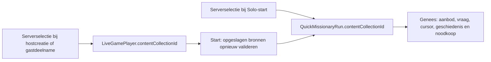

# Fase 1E — Oorspronkelijke uitgave voor Snelle Zendeling en Genees

## Scope en beginsituatie

Branch `codex/content-architecture-v2-1e-genees-source`, vanaf `origin/main`
`e09ab439` (gemergede PR #90). Alleen de afzonderlijk goedgekeurde uitbreiding
voor bronvastlegging. Geen productiequery, seed, import, deployment of merge.

`QuickMissionaryRun` en `LiveGamePlayer` bewaarden geen collectie-ID.
`runs.ts` gebruikte `activeCollectionId(userId)` bij Genees-aanbod,
vraaguitgifte en noodkoop. Daardoor wijzigde een profiel-/taalwissel de bron
van een bestaande run. Samen bepaalde de deelnemers pas bij start, zonder
uitgave-snapshot. Sommige hervatpagina's/socketguards veronderstelden bovendien
`content_bom`, ook voor een andere oorspronkelijke taaluitgave.

## Additief schema

Migratie `20261027120000_quick_missionary_source`:

- Nullable `QuickMissionaryRun.contentCollectionId`, relatie
  `QuickMissionaryRunSource` naar `ContentCollection.id`.
- Nullable `LiveGamePlayer.contentCollectionId`, relatie
  `QuickMissionaryLobbySource`; andere spelmodi houden NULL.
- Eén index per nieuwe FK; inverse relaties op `ContentCollection`.
- `ON DELETE RESTRICT` en `ON UPDATE RESTRICT`: verwijdering/hernoeming van een
  gerefereerde bron wordt geweigerd, geen historische run of bronidentiteit
  verdwijnt. Zichtbaarheid/publicatie kan volgens bestaande beheerregels wijzigen.
- Geen backfill, nieuwe defaults, gewijzigde historische migraties of nieuwe
  werken. Alle bestaande bronvelden beginnen NULL.

Alle DDL staat in één PostgreSQL DO-statement, met lokale lock-timeout.
Een onverwachte bestaande bronkolom veroorzaakt
`QUICK_MISSIONARY_SOURCE_REVIEW_REQUIRED`; geen gedeeltelijke uitbreiding.
Herhaald `prisma migrate deploy` past een geregistreerde migratie niet opnieuw toe.
De ruwe SQL is geen los handmatig herhaalbaar backfillscript.

## Waarom twee snapshots

Een lobby kan lang openstaan. Alleen een runbron bij gezamenlijke start
vastleggen zou alsnog de profielkeuze ná deelname gebruiken. Daarom:

`source.ts` hergebruikt `getActiveGameCollection` en `checkGameAvailability`.
De bestaande services accepteren additief een transactionele databaseclient;
hun oude aanroepcontracten en querybudgetten blijven intact. Er is geen
parallelle spelcontentresolver of synthetische BOM-fallback toegevoegd.

## Solo en Samen

### Solo

`startQuickMissionaryRun` valideert binnen de domeintransactie de serverselectie,
normale contentrechten, technische ondersteuning, GameSettings en scope.
Daarna wordt exact dat collectie-ID op de nieuwe run geschreven. Een collectie-ID
in een clientpayload bepaalt nooit de bron.

### Samen

`createQuickMissionaryLobby` bewaart de gevalideerde hostbron atomair met de
lobby en hostdeelname. `joinQuickMissionaryLobby` controleert de echte lobby,
lidmaatschap/uitnodiging en voor een nieuwe deelname de actuele serverselectie.
Reconnect behoudt een bestaande snapshot en toetst uitsluitend normale
bronrechten; gewijzigde voorkeur, settings en scope blokkeren hervatten niet.

Join, leave en `startMatch` nemen eerst dezelfde PostgreSQL-lobbylock.
Start valideert alle opgeslagen deelnemerbronnen vóór enige match/runmutatie.
Beschikbaarheid wordt binnen de transactie één keer per unieke opgeslagen
uitgave gecontroleerd, zodat grote lobby’s geen identieke catalogusqueries
per deelnemer herhalen. Elke run krijgt vervolgens zijn eigen deelnemerssnapshot. Ontbrekende of
ontoegankelijke bronnen weigeren alleen de nieuwe start: lobby en uitnodigingen
blijven staan. Een dubbele start retourneert dezelfde wedstrijd en starttijd,
zonder nieuwe runs. De socketpayload leest de opgeslagen wedstrijd-ID opnieuw,
zodat ook een andere serverinstance de start herkent.

Na start blijven de bestaande lockvolgorde **wedstrijd → run → gebruiker**,
klok, eliminatievolgorde, Duo-afsluiting, heartbeat en reconnectregels gelden.

## Genees, bronrechten en economie

- Aanbod, uitgifte en noodkoop gebruiken uitsluitend de runbron.
- Vóór verbruik wordt de vraagbank op echt bruikbare antwoordsets gecontroleerd.
  Lege/concept-/onbruikbare banken veroorzaken geen aankoop of verbruik.
- Uitgifte staat onder de bestaande runlock en per-gebruiker-vraagselectielock.
  De vraag, optievolgorde, SHOWN-registratie en voorraadmutatie blijven één transactie.
  Retry/twee toestellen hergebruiken dezelfde uitgegeven poging.
- Beantwoording controleert de opgeslagen vraag-ID, optie-ID én collectie van
  die vraag. Cursor en geschiedenis blijven per gebruiker/collectie gescheiden.
- Huidige profielkeuze, GameSettings en scope worden niet opnieuw gebruikt
  voor Genees of het hervatten van een bestaande geldige run.
- Normale leesrechten gelden ook voor admins. Hidden, disabled en DRAFT
  blokkeren nieuwe vraaginhoud, beantwoording en noodkoop. Vraagresponses en
  leesverwijzingen zijn bovendien op normale bronrechten gefilterd.
- Een uitgegeven vraag met tijdelijk ingetrokken toegang blijft opgeslagen;
  de UI toont een melding en een veilige beëindigingsactie. Bij herstelde
  rechten komt dezelfde vraag/optievolgorde terug, zonder nieuw verbruik.
  De bestaande wedstrijdklok en disconnecttermijnen blijven van toepassing.

Prijs, gratis Genees, voorraad, noodkooplimiet, XP-ledger, scores, rankings,
feedback en reeksregels zijn niet gewijzigd. Een bron-/contextwijziging kent
geen beloning toe. Geen hint-/voortgangsreset of nieuwe speladapter.

## Expliciet beleid voor oude records

| Bestaande toestand | Gedrag |
|---|---|
| NULL-runbron met uitgegeven vraag | Alleen de echte vraag → hoofdstuk → boek → collectie bewijst de bron. GET schrijft niets; uitgifte-retry/antwoord/hervatten legt de bewezen bron onder de bestaande runlock vast. Normale rechten en status worden gecontroleerd. |
| NULL-runbron zonder aantoonbare vraag | Geen profiel-/BOM-gok en geen nieuwe Genees/noodkoop. De run kan doorgaan en veilig eindigen met bestaande score/ranking. Na een botsing volgt de bestaande afrondingsflow met een verklaring. |
| Oude REVIVE_READY zonder vraag en bron | Het al verdiende leven mag worden hervat; de bron blijft NULL. Een volgende botsing geeft geen nieuwe Genees. |
| Oude Samen-run zonder bron | Dezelfde per-runregels; opgeven/botsing/disconnect gebruikt de bestaande eliminatie-/Duo-afhandeling. Er wordt geen nieuwe bron verzonnen. |
| Oud lobbylid zonder snapshot | Reconnect wist/verandert niets. Een expliciete knop bevestigt de huidige, normaal toegankelijke serverselectie. Iedereen moet bevestigen vóór een nieuwe wedstrijd kan starten. |
| Bron verwijderd/ontbreekt | Nieuwe FK's verhinderen verwijdering zolang een snapshot bestaat. Ontbrekende/ongeldige historische relaties geven geen nieuwe vragen of kosten. |

Hervatpagina's controleren eigenaarschap/lidmaatschap of uitnodiging, niet een
willekeurige vaste BOM-editie. Hun veilige arcademetadata en beëindiging blijven
bereikbaar; Genees-inhoud heeft afzonderlijk de originele normale bronrechten.
De actieve-spellenlijst gebruikt voor een QM-deelnemer zijn snapshot en
presenteert een ontbrekende bron niet als bewezen BOM.

Bij hervatten van een bestaande Solo-run blijft de opgeslagen score het
beginpunt van de clientwereld, ook voor oude NULL-runs. Hiermee kan een oude
lopende run niet op nul terugvallen en daarna door monotone scorevalidatie
onafsluitbaar worden. Obstakels, scoretempo en difficultyformule blijven gelijk.

## Validatie en bewijs

De runner `npm run test:snelle-zendeling:integration` gebruikt uitsluitend eigen
lokale PostgreSQL 16- en Redis 7-containers. Hij bouwt synthetische fixtures
met de gecontroleerde collectiearchitectuur; geen productiegegevens.

Hij test achtereenvolgens:

1. Historische migraties en 1A/1B-compatibiliteit.
2. Oude Solo-/Samen-/andere-modusrecords, vragen, optievolgorde, geschiedenis
   en aankoop-audit vóór 1E. Fingerprints over **133 bestaande tabellen**.
3. DDL-abort, onverwachte bronkolom, lock-timeout, FK-conflict en herhaald deploy.
4. Bestaande Snelle Zendeling-/Genees-/economietests zonder DB-skips.
5. Nieuwe bron-, legacy-, rechten-, leeg-bank-, concurrency- en kostenregressies.
6. Twee echte `server.ts`-productie-instances met gezamenlijke eigen PostgreSQL
   en Redis: uitnodiging, snapshots, reconnect, dubbele start, Genees en Duo.
7. Chromium tegen de productiebuild: oude run afronden, opgeslagen score
   behouden en oude lobby expliciet bevestigen. 320px donker en 1280px licht;
   de mobiele lobby ook met 200% tekst. Screenshots als CI-artifact.
8. Bestaande fase-1D-querybudgetten: context **16/7/8/5**, toegestane/geweigerde
   directe puzzelstart **5/3**. Geen rechten-/settingscache toegevoegd.

### Uitgevoerde lokale eindcontroles

| Controle | Resultaat |
|---|---|
| `test:snelle-zendeling` op eigen DB | 173 geslaagd, 0 overgeslagen |
| `test:genees-economy` op eigen DB | 58 geslaagd, 0 overgeslagen |
| Nieuwe bronregressies + Solo-isolatie | 18 geslaagd, 0 overgeslagen |
| Twee instances + productie-browser | 2 geslaagd, 0 overgeslagen |
| `test:content-access:integration` | 132 unit/HTTP/DB-tests geslaagd; ook migratiebehoud en querybudgetten |
| Socketrunner `--socket-only` | 45 echte socketcontroles en 7 kaartregressies geslaagd |
| Gerichte content-/studiecontext-/route-/editie-/tijdzonetests | 66 geslaagd |
| `test:live-data` / `test:focus` | 51 / 22 geslaagd |
| Prisma validate/generate, TypeScript en schone productiebuild | Geslaagd |
| ESLint | Geen fouten; 133 bestaande waarschuwingen, geen nieuwe |
| i18n | Vier nieuwe sleutels in alle vijf talen; 423 bestaande ontbrekende sleutels per secundaire taal onveranderd |

De verwachte CHECK-/FK-/DDL-fouten zijn bewust uitgelokte rollbacktests en
geen overgeslagen integratievalidatie. Initiële testfixture-/testassertieproblemen
zijn gecorrigeerd; een build-/serverstartoverlap en tijdelijke volle lokale
schijf zijn opgelost en opnieuw gecontroleerd.

### Prestatiecontrole

80 gemeten samples per geval, na 10 warm-ups, tegen eigen synthetische data:

| Geval | Queries | Mediaan (ms) | p95 (ms) |
|---|---:|---:|---:|
| BOM-context, alle scopes | 16 | 15,149 | 21,346 |
| Podcastcontext | 7 | 3,162 | 4,021 |
| BOM-context, één scope | 8 | 3,559 | 4,915 |
| BOM-context, geen scope | 5 | 2,382 | 2,862 |
| Nieuwe puzzelstart toegestaan | 5 | 2,232 | 3,288 |
| Nieuwe puzzelstart geweigerd | 3 | 1,615 | 3,040 |

De fase-1D-querybudgetten blijven exact behouden. Dit zijn lokale metingen,
geen productie-SLA of bewijs voor NAS-latency.

### Browserbewijs en CI

Productiebuild in Chromium: 320×844 donker en 1280×844 licht; de mobiele
lobby op 200% tekst. Teruggegeven status, opgeslagen bron, score, economie,
werkelijke knopinteractie/desktop Enter en horizontale overflow worden
gecontroleerd. Screenshots: `legacy-run-320.png`, `legacy-run-1280.png`,
`legacy-lobby-320.png` en `legacy-lobby-1280.png`, artifact
`quick-missionary-source-browser` op de content-access-workflow.

De bestaande content-access-workflow bevat een gerichte
`quick-missionary-source`-job met dezelfde eigen DB/Redis-runner en browser.
De andere toepasselijke workflows blijven behouden. De concept-PR/checks op
de exacte gepushte commit zijn de uiteindelijke CI-bron van waarheid.
Screenshots/buildbestanden en eigen databasecredentials zijn niet in Git opgenomen.

## Uitrol en rollback

1. Concept-PR, diff, CI en migratie afzonderlijk laten beoordelen. Geen
   productiedatabasewijziging is door deze PR-uitvoering geautoriseerd.
2. Eigenaar bevestigt bij een later uitrolbesluit recente, passende Synology
   Hyper Backup-dekking voor database/media. De aanvullende herstelproef is
   bewust overgeslagen; herstelbaarheid is **niet onafhankelijk getest**.
3. Rekening houden met automatische `prisma migrate deploy` bij containerstart.
   Dus geen nieuwe image/container starten vóór afzonderlijke toestemming.
4. Kies een rustig uitrolmoment vanwege korte DDL/FK-locks. Bij timeout/conflict:
   stop de uitrol, beoordeel de afwijking en Prisma-migratiestatus. Niet seeden,
   overschrijven, handmatig backfillen of een mislukte migratie blind als geslaagd markeren.
5. Na goedgekeurde deploy: normale Solo-/Samen-start in eigen accounts,
   bronwissel tijdens run, Genees-bron en oude lobbybevestiging controleren.
   Geen algemene contentreload nodig.
6. Bij approllback de additieve kolommen/FK's/indices behouden. Geen historische
   bronwaarden verwijderen. Een oudere app negeert de velden en brengt de oude
   Genees-bronwisselbug terug; kies bij voorkeur een gerichte herstelpatch.
   Database-rollback/destructieve contractmigratie vraagt afzonderlijke beoordeling.

## Bewuste beperkingen

- Oude NULL-runs zonder aantoonbare vraag kunnen niet alsnog de oorspronkelijke
  uitgave krijgen. Dat is bewust gegevensbehoud, geen ontbrekende backfill.
- Geen extra contentondersteuning: bestaande fase-1D-capabilities blijven leidend.
- Twee instances op één testhost bewijzen gedeelde DB/Redis-concurrency, geen
  geografisch multi-hostnetwerk of fysieke Capacitor/iOS/Android-validatie.
- Geen productievolume-/latencybenchmark of bewezen productiebackup-herstel.
- Fase 1B/1C/1D-architectuur blijft intact; geen volgende contentfase gestart.
