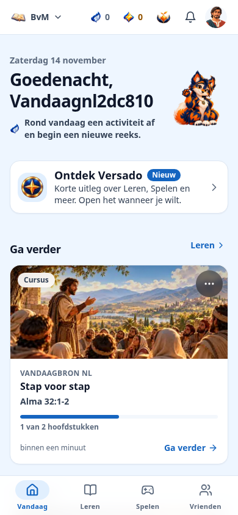
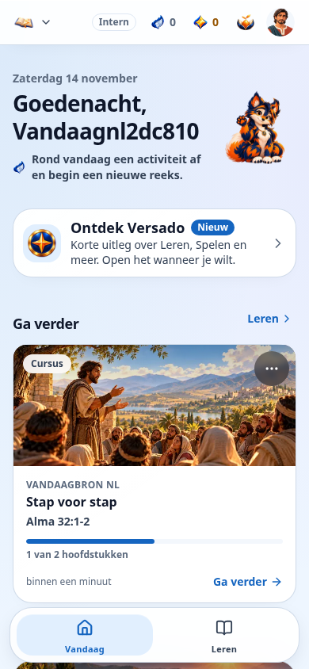
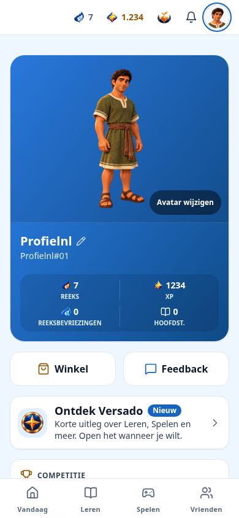
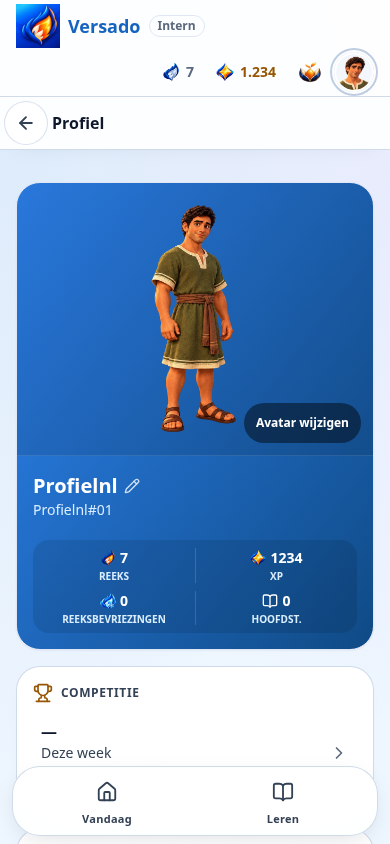

# Liquid Glass — echte browserbeelden

Deze PNG's komen uit de bestaande profiel- en Vandaag-browserproeven, met de
nieuwe iOS-materiaalvariant en de echte Next-productiebuild ernaast. Ze tonen
werkende gedeelde componenten en uitsluitend synthetische lokale accounts,
content en assets. Geen ontwerpplaatjes, remote website in de app of foto's
van een iPhone. De UIKit-voorkeurgrens is gesimuleerd in Chromium; op het toestel
levert de bestaande lokale Capacitor-plugin deze instellingen.

## Vandaag en profiel — 390px, lichte modus

| Web | Lokale iOS-presentatie |
| --- | --- |
|  |  |
|  |  |

## Donker, instellingen en toegankelijkheid

| Controle | Werkelijke screenshot |
| --- | --- |
| Vandaag, donkere modus, 375px, normale tekst | [today-native-dark.png](today-native-dark.png) |
| Profiel, donkere modus, 320px, 200% tekst | [profile-native-dark-200.png](profile-native-dark-200.png) |
| Gedeelde taalinstellingen | [profile-native-language.png](profile-native-language.png) |
| Reduce Transparency + Increase Contrast | [profile-native-opaque.png](profile-native-opaque.png) |
| Echte HTML-bevestigingsdialoog, 200%, focusval en Escape | [profile-native-sheet-200.png](profile-native-sheet-200.png) |
| Compatibiliteitsdialoog zonder showModal, 310% | [profile-native-compatible-sheet-310.png](profile-native-compatible-sheet-310.png) |
| Viewportverkleining met actief invoerveld; tabbar volgt bestaande keyboardregel | [profile-native-keyboard.png](profile-native-keyboard.png) |
| 310%: dezelfde tablabels als leesbare rijen; interne fixturebediening zichtbaar | [profile-native-large-310.png](profile-native-large-310.png) |

De browserketen toetst Nederlands, Engels, Duits, Frans en Spaans. De volledige
set wordt door de bestaande CI-artifactstap onder `liquid-glass` bewaard; deze
map bevat alleen representatieve voorbeelden. Normale pixelmaten blijven een
browserproef: viewportverkleining is geen bewijs van fysieke IME-/VoiceOverwerking.
De interne fixture toont `Intern`; een echte distributiebuild blijft zijn
bestaande TestFlight-buildindicator gebruiken.

## Reproduceren

Na de gewone schone productiebuild en lokale native bundel:

```sh
npm run build
NATIVE_API_BASE_URL=https://example.invalid npm run native:build
node scripts/native/test-isolated.mjs --glass-only
```

Deze bestaande keten start eigen PostgreSQL, Redis en de productietestserver,
toetst migratiebehoud en draait dezelfde profiel-/Vandaag-suites. Geen NAS,
Cloudflare of echte accounts. De standaard native CI blijft alle andere suites
ook uitvoeren; `--glass-only` is uitsluitend een gerichte lokale herhaling.

De screenshots zijn vastgelegd na de definitieve materiaal-, dialoog- en
grote-tekstwijzigingen. Fysieke iPhone/iPad-acceptatie voor VoiceOver,
rotatie, IME, scrollprestaties en batterij blijft vereist.
